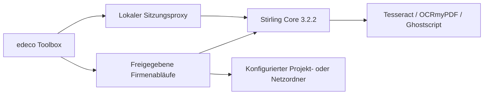

# PDF-Werkstatt: Stirling integrieren

**Entscheidung:** Die vorhandene Stirling-PDF-Core-Oberfläche und ihre
Verarbeitung werden in die bestehende edeco Toolbox integriert. Eine neue
PDF-Engine oder ein zweiter Desktop-Unterbau wird für diesen Schritt nicht
entwickelt. Name: **edeco PDF-Werkstatt**.

## Vergleich der Ansätze

| Aspekt | Stirling-PDF anpassen | Neue Tauri-/React-Anwendung |
| --- | --- | --- |
| Vorhandene Funktionen | PDF-Werkzeuge, Seitenvorschau, Signieren, Schwärzen, Konvertierung und OCR bereits vorhanden | Werkzeuge, Editor, Vorschau und sichere Abläufe müssen integriert und geprüft werden |
| Betrieb | Java-/Docker-Dienst auf demselben PC oder einmal im Firmennetz | Pro PC native Runtime, PDF-Bibliotheken und OCR-Programme ausrollen |
| Firmenanpassung | Bestehende Oberfläche einbetten; Logo, Farben, erlaubte Endpoints und Workflows ergänzen | Volle UI-Kontrolle, aber deutlich mehr eigener Funktionscode |
| Datenschutz | Eigener PC/interner Dienst; keine öffentliche PDF-Cloud nötig | Lokale Verarbeitung möglich; Abhängigkeiten und Netzverhalten selbst verantworten |
| Pflege | Upstream-Version fixieren und Integration bei Updates prüfen | Eigenen Editor, alle Formate und Plattformpakete dauerhaft pflegen |
| Passung zur Toolbox | Vorhandenen React-/Python-/WebView-Desktop und Updateweg nutzen | Tauri wäre ein zusätzlicher Desktop-Unterbau; für eine neue eigenständige Anwendung sinnvoller |

Für diesen Firmenkontext ist die **Stirling-Integration** der kürzere Weg zu
einem breiten PDF24-Ersatz. Ein gemeinsamer Dienst spart Docker-/Java-/OCR-
Installationen auf den einzelnen Toolbox-PCs. Wenn Dateien den jeweiligen PC
nicht verlassen dürfen, kann derselbe Dienst ausschliesslich lokal laufen.

## Version und Lizenzen

Geprüft wurde Stirling **3.2.2**, veröffentlicht am 24.10.2026. Das Projekt ist
inzwischen Open Core: Seine [Hauptlizenz](https://github.com/Stirling-Tools/Stirling-PDF/blob/v3.2.2/LICENSE)
nimmt unter anderem proprietäre Erweiterungen, AI-Engine und bestimmte
Desktop-/Processor-Bereiche aus. Daher ist „alles auf GitHub ist MIT und frei
white-labelbar“ keine korrekte Annahme.

Diese Integration verwendet den offiziellen **Core-/Ultra-Lite-Build** plus
lokale OCR-Programme. Der [Upstream-Build](https://github.com/Stirling-Tools/Stirling-PDF/blob/v3.2.2/docker/embedded/Dockerfile.ultra-lite)
setzt `DISABLE_ADDITIONAL_FEATURES=true`; die [Build-Konfiguration](https://github.com/Stirling-Tools/Stirling-PDF/blob/v3.2.2/settings.gradle)
und der [Frontend-Build](https://github.com/Stirling-Tools/Stirling-PDF/blob/v3.2.2/frontend/vite.config.ts)
unterscheiden Core, proprietäre, SaaS- und Desktop-Varianten. Die kommerzielle
AI-Engine wird nicht eingebaut. Lizenzprüfungen werden nicht entfernt.

Enterprise-Benutzerverwaltung, bezahlte Pläne und deren Grenzen bleiben eine
separate Entscheidung. Auch transitive Bibliotheken und Kommandozeilenprogramme
behalten ihre jeweiligen Lizenzen. Bei einer eigenen Weiterverteilung des
Containers die Upstream-/Paket-Lizenzhinweise mitführen.

Für einen eigenen Tauri-Ansatz wären `pdf-lib` (MIT), PDFium (BSD-artig) und
Tesseract (Apache 2.0) mögliche Bausteine. PyMuPDF hat AGPL-/kommerzielle
Lizenzoptionen und ist daher keine pauschal permissive Austauschbibliothek.

## Aufbau



- `ui/src/tools/pdf-workshop/PdfWorkshop.tsx`: Toolbox-Kopf, Dienstverbindung,
  eingebettete Originaloberfläche, Firmenabläufe und Hinweis beim Verlassen
  eines Arbeitsbereichs mit geöffneten Dateien.
- `backend/edeco_toolbox/pdf_workshop/api.py`: Proxy unter
  `/tools/pdf-werkstatt/`, Origin-/Sitzungsschutz, Streaming ohne vollständiges
  Puffern grosser Downloads, gemeinsame HTTP-Verbindungen und Branding.
- `client.py`: modularer, von React/FastAPI unabhängiger Controller für die
  vorhandene Stirling-REST-API. Keine eigene PDF-Verarbeitung.
- `config.py`: zentrale Firmenvorgaben oder persönliche Dienstadresse.
- `assets/`: edeco-SVG, Farbvariablen und kleiner Integrationshook; keine
  Kopie des Stirling-Editors und keine ersetzten Lizenzfunktionen.
- `deployment/pdf-workshop/`: festgelegtes Image, OCR-Erweiterung, Compose und
  Beispiel für Firmenprofile.

Stirling wird mit `SYSTEM_ROOTURIPATH=/tools/pdf-werkstatt` gestartet. Sein
Laufzeit-`<base>` hält Assets und API-Aufrufe unter diesem Pfad. Die Toolbox
ergänzt Logo und Styles an der Originaloberfläche. Der Dienst ist ein
vertrauenswürdiger Bestandteil der Anwendung: nur den eigenen Stirling-Dienst
eintragen, keine beliebige öffentliche Webseite. Der lokale Proxy prüft Host,
Origin und Sitzung, ersetzt aber keine zentrale Dienst-Authentifizierung.

## Die drei zentralen Operationen

Vollständige Implementierung: `backend/edeco_toolbox/pdf_workshop/client.py`.
Sie lässt sich unverändert hinter React, Tauri oder einer anderen API verwenden:

```python
from pathlib import Path
from edeco_toolbox.pdf_workshop.client import StirlingClient, PdfFile, Crop

pdf = StirlingClient("http://127.0.0.1:8088")
first = PdfFile.read(Path("Plan-A.pdf"))
second = PdfFile.read(Path("Plan-B.pdf"))

# 1. Zusammenfügen, Reihenfolge bleibt erhalten.
Path("Gesamt.pdf").write_bytes(pdf.merge([first, second]))

# 2. Zuschneiden und skalieren: PDF-Punkte, Ursprung links unten.
# 72 Punkte entsprechen einem Zoll. Das Rechteck muss zum Eingabeplan passen.
cropped = pdf.crop(first, Crop(x=20, y=420, width=300, height=400))
Path("Ausschnitt.pdf").write_bytes(cropped)
Path("A3.pdf").write_bytes(pdf.resize(first, page_size="A3", scale_factor=1.0))

# DPI gehört zur Rasterausgabe. Vektor-PDF-Seitenskalierung hat keine DPI.
# Je nach Seitenzahl liefert Stirling PNG oder eine ZIP mit PNG-Dateien.
images = pdf.raster_images(first, dpi=300)
Path("Seiten.zip" if images.startswith(b"PK") else "Seite.png").write_bytes(images)

# 3. Scan als durchsuchbares PDF, vorhandenen Text standardmässig erhalten.
scan = PdfFile.read(Path("Scan.pdf"))
Path("Scan-durchsuchbar.pdf").write_bytes(pdf.ocr(scan, languages=("deu", "eng")))
```

Zuschneiden ist kein Ersatz für sicheres Schwärzen. Bildinhalte können trotz
eines geänderten sichtbaren Bereichs im PDF enthalten bleiben. Für Redaktionen
das dafür vorgesehene Stirling-Werkzeug verwenden. Bearbeitung einer bereits
digital signierten Datei kann die Signatur ungültig machen; ein visueller
Stempel ist keine kryptografische Signatur.

Die Integration und die echten Engine-Prüfungen decken Merge, Crop/Resize,
OCR, Raster-DPI und Stempel ab. Nicht jede einzelne upstreamseitige PDF-Funktion
wird dadurch fachlich oder kryptografisch zertifiziert. Nicht installierte
Abhängigkeiten, etwa weitere Office-Konverter, können weitere Werkzeuge
einschränken; die Oberfläche kann diese ausblenden.

## Firmen-Branding und Workflows

Beispiel: `deployment/pdf-workshop/company.example.json`. `title` und `accent`
ändern Namen und Kennfarbe. Das Logo kommt aus `assets/edeco-logo.svg`, die
gemeinsamen Oberflächenfarben aus `theme.css`. Die Einstellungen wirken nur auf
die Oberfläche, nicht auf Zeichnungsfarben im PDF.

Endpunkte werden im Dienst über `ENDPOINTS_TOREMOVE` beziehungsweise die
Stirling-Einstellungen deaktiviert. `UI_DEFAULTHIDEUNAVAILABLETOOLS=true` und
`UI_DEFAULTHIDEUNAVAILABLECONVERSIONS=true` reduzieren die Oberfläche.

Firmenabläufe sind freigegebene Profile, keine frei vom Browser vorgegebenen
Zielpfade. Der Beispielablauf lässt Stirling `ENTWURF` stempeln und legt die Datei
unter einem neuen Namen im konfigurierten Netzordner ab. Ein nicht erreichbares
Laufwerk führt zu einem Fehler statt zu einer Ablage an einem anderen Ort.

Deployment und Grenzen: [Dienst ausrollen](../deployment/pdf-workshop/README.md).
